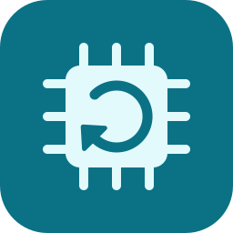

# Simple EspHome Updater

Home Assistant integration that adds an update entity plus flash and compile buttons per ESPHome device, driven by your [ESPHome Dashboard](https://esphome.io/guides/getting_started_command_line/):

Per device:

| Entity | Does |
|---|---|
| **Firmware** (update entity) | installed vs. available ESPHome version. *Install* = compile + OTA upload, with progress in percent (compile 0-50 %, upload 50-100 %) |
| **Flash** (button) | compile + OTA upload on every press, even without a new version |
| **Compile** (button) | compile only, no upload |

Use **Flash** to roll out changes that do not bump the ESPHome version, e.g. updated remote packages or `external_components`.

Each device carries the MAC address of the ESPHome device as connection. Home Assistant (2026.8+) keeps one device per integration, and links devices with the same MAC: the ESPHome device page shows this device as linked.

## Install

1. Add the repository in the Marketplace (badge above), or as a custom repository: `b2un0/simple-esphome-updater`, type *Integration*.
2. Install, restart Home Assistant.
3. *Settings -> Devices & services -> Add integration -> Simple EspHome Updater*.

## Configuration

| Field | Description |
|---|---|
| URL | Dashboard address, e.g. `http://192.168.1.10:6052` |
| Username | Dashboard login, empty if none |
| Password | Dashboard login, empty if none |

Home Assistant must reach the dashboard over HTTP. The dashboard must reach the devices (OTA).

## Behaviour

- Devices are read from the dashboard every 5 minutes; new devices get buttons automatically.
- A press starts a background job. Buttons are unavailable and the update entity shows progress while it runs. One job at a time per dashboard, others wait.
- On failure a persistent notification shows the last log lines.

## Development

CI: HACS action, hassfest, ruff. Release: bump `version` in `manifest.json`, tag `vX.Y.Z`.

## License

MIT
